# Pepe's Forge Items

Detailed item and recipe reference for the current Pepe's Forge item set.

Unless stated otherwise, listed values are the default values. Server administrators can override values marked as configurable in `config.yml` or `/pepeforge config`.

## Table of Contents

- [Chisel](#-chisel)
- [Scythe](#-scythe)
- [Wind Blade](#️-wind-blade)
- [Greatsword](#️-greatsword)
- [Rapier](#rapier)
- [Crescent Bow](#-crescent-bow)
- [Crescent Spear](#-crescent-spear)
- [Crescent Khopesh](#-crescent-khopesh)
- [Katana](#️-katana)
- [Solar Shield](#️-solar-shield)
- [Crimson Sword](#-crimson-sword)
- [Anchor](#-anchor)
- [Throwing Knife](#-throwing-knife)
- [Stormcleaver](#-stormcleaver)
- [Emberfang](#-emberfang)
- [Obsidian Glaive](#obsidian-glaive)
- [Give Names](#give-names)

## 🪚 Chisel

Decorative utility tool for cycling supported block variants.

| Feature | Details |
|---------|---------|
| Use | Right-click a supported block to advance one decorative variant |
| Reverse | Sneak + right-click to cycle backward |

**Crafting** (Shaped Recipe):

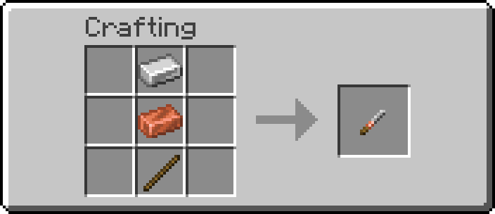

## 🌾 Scythe

Farming tool for harvesting ripe crops and replanting them automatically.

| Tier | Harvest Area | Effect |
|------|--------------------|--------|
| **Iron Scythe** | 3×3 | Harvests ripe crops, replants from drops |
| **Diamond Scythe** | 5×5 | Harvests ripe crops, replants from drops |
| **Netherite Scythe** | 7×7 | Harvests ripe crops, replants from drops |

**Supported Crops**:
- Wheat
- Carrots
- Potatoes
- Beetroots
- Nether Wart

Replant order: Uses harvested seeds first, then inventory fallback.

**Crafting** (Shaped Recipe):

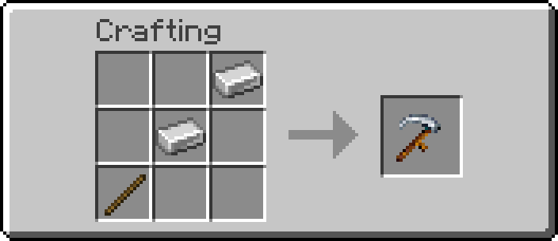

Netherite upgrade uses Smithing Table with Diamond Scythe + Netherite Ingot.

## ⚔️ Wind Blade

Elemental melee weapons with speed effects.

| Tier | Attack Damage (HP) | Effect |
|------|--------------------|--------|
| **Iron Wind Blade** | 5 | Speed I for 2 seconds on hit |
| **Diamond Wind Blade** | 6 | Speed I while holding |
| **Netherite Wind Blade** | 7 | Speed I while holding + Speed II for 3 seconds on hit |

| Feature | Details |
|---------|---------|
| Dash | Right-click to activate a dash ability. Default cooldown: 5 seconds and strength: 1.5. Dash cooldown, strength and gliding behavior (disabled by default) are configurable. Available on all tiers. |

**Crafting** (Shaped Recipe):

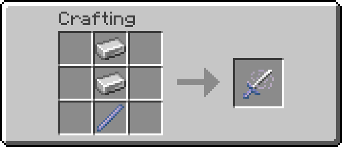

Netherite upgrade uses Smithing Table with Diamond Wind Blade + Netherite Ingot.

## ⚔️ Greatsword

Two-handed rhythm weapons for extended reach, widening area cuts, and space control.

| Tier | Attack Damage (HP) | Effect |
|------|--------------------|--------|
| **Iron Greatsword** | 6 | Same rhythm mechanics, lower damage |
| **Diamond Greatsword** | 7 | Same rhythm mechanics, higher damage |
| **Netherite Greatsword** | 8 | Same rhythm mechanics, highest damage |

| Feature | Details |
|---------|---------|
| Rhythm | Well-timed swings build rhythm stages |
| Sweeping Cut | Timed swings trigger a forward area attack with a wider arc at higher rhythm stages |
| Cleave | Direct hits also damage nearby targets |
| Defense | Active rhythm reduces incoming frontal damage |
| Projectile Resistance | Enabled by default from the first rhythm stage; whether projectile knockback is ignored is configurable |
| Micro Dash | Enabled by default. Successful attacks add a short forward dash; the enabled state and default strength of 0.15 are configurable |
| Break Penalty | Bad timing or timeout briefly applies Mining Fatigue |
| Restriction | Requires an empty off-hand for custom mechanics |

**Crafting** (Shaped Recipe):

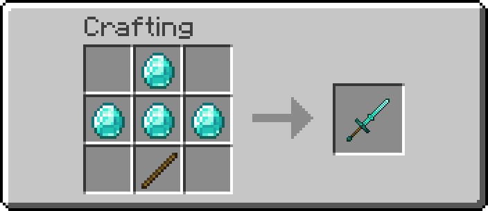

Netherite upgrade uses Smithing Table with Diamond Greatsword + Netherite Ingot.

## Rapier

Fast, one-handed swords combining precise thrusts with sweeping cuts.

| Tier | Default Attack Damage (HP) |
|------|----------------------------|
| **Iron Rapier** | 5 |
| **Diamond Rapier** | 6 |
| **Netherite Rapier** | 7 |
| **Ice Rapier** | 8 → 4 as the blade wears |

The Rapier tier damage values in the table are defaults and are configurable.

| Feature | Details |
|---------|---------|
| Controls | Left-click to attack. Sneak + right-click to switch between Thrust and Cut. |
| Thrust | Default mode. Hits a single target with 3.75-block reach. |
| Cut | Sweeping cuts with normal sword reach. |
| Off-hand | Allows an off-hand shield; ordinary right-click uses it. |
| Attack Speed | Default: 2 attacks per second. Configurable. |
| Frontal Bonus | Disabled by default. When enabled, Thrust gains the default 20% damage bonus at 90% or greater attack charge within the target's front 120-degree cone. Whether it is enabled, the bonus and the cone are configurable. |

**Ice Rapier** has **32 durability points** by default and applies freezing with both Thrust and Cut. Its default damage range is 8 → 4 HP and its default freeze-meter value is 200; damage endpoints, maximum durability and freeze meter are configurable.

**Crafting** (Shaped Recipe):

|   |   |   |
|---|---|---|
| Empty | Empty | Empty |
| Stick | Iron Ingot | Iron Ingot |
| Empty | Empty | Empty |

Netherite upgrade uses Smithing Table with Diamond Rapier + Netherite Ingot.

### 🎑 Shared Crescent Rules

The following rule applies only to Crescent Bow, Crescent Spear and Crescent Khopesh: each deals 1 less damage during the day and 2 bonus damage at night under open sky.

## 🏹 Crescent Bow

Moon-themed ranged weapon that fires a three-arrow volley.

| Feature | Details |
|---------|---------|
| Arrows | Fires a 3-arrow crescent spread (center + 2 sides) |
| Ammo | Consumes 1 arrow per volley |
| Visual | Subtly shimmers under moonlight |

**Crafting** (Shaped Recipe):

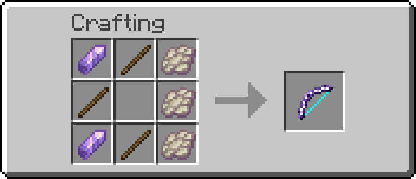

## 🔱 Crescent Spear

Moon-themed melee weapon with an armed follow-up burst.

| Stat | Value |
|------|-------|
| Attack Damage (HP) | 5 |

| Feature | Details |
|---------|---------|
| Charge | Each successful attack adds a charge. Default: 5 charges required; the required charges are configurable. Partial charge loses one charge every 2 seconds; full charge stays ready until used. |
| Active | The next melee hit at full charge triggers 2 rapid follow-up attacks by default; the active hit count is configurable. The final hit lightly knocks the target back and upward |
| Visual | Subtly shimmers under moonlight |

**Crafting** (Shaped Recipe):

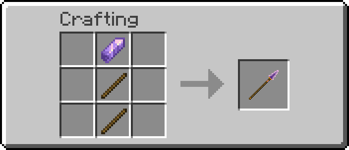

## 🌙 Crescent Khopesh

Moon-themed melee weapon with a lunar slash and temporary shield.

| Stat | Value |
|------|-------|
| Attack Damage (HP) | 6 |

| Feature | Details |
|---------|---------|
| Moonstrike | Every third hit by default unleashes a lunar slash. The hit count and mode are configurable.|
| Shield | Each accepted target grants 0.5 shield HP, up to 4 HP by default, for 4 seconds. The shield limit is configurable. |

**Crafting** (Shaped Recipe):

| | | |
|---|---|---|
| Empty | Amethyst Shard | Empty |
| Iron Nugget | Amethyst Shard | Iron Nugget |
| Empty | Stick | Empty |

## 🗡️ Katana

Two-handed parry weapon with increased attack reach.

| Stat | Value |
|------|-------|
| Attack Damage (HP) | 5 |
| Attack Range Bonus | +0.75 blocks |

| Feature | Details |
|---------|---------|
| Parry | Right-click to block melee attacks and reflect projectiles. |
| Counterattack | Successful melee parries deal 1 damage and knock the attacker back. |
| Restriction | Requires an empty off-hand. |

**Crafting** (Shaped Recipe):

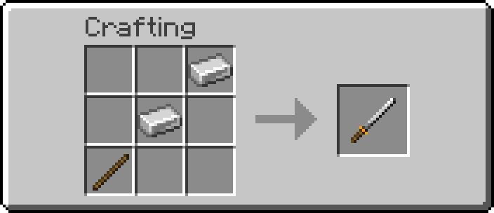

## ☀️ Solar Shield

A legendary sun-blessed shield that charges passively in strong sky light.
*Ancient Cities were not always shrouded in darkness...*

| Feature | Details |
|---------|---------|
| Capacity | Holds up to 3 charges. In strong sunlight, each charge takes up to 15 seconds to gain; darkness discharges each charge over 20 seconds. |
| Passive Charging | Charges while held in strong daylight. |
| Retaliation | While blocking, getting hit consumes 1 charge to ignite attackers and trigger a 2-second blinding flashbang effect. |
| Discharge | Loses charges in darkness, shade and while the shield is not equipped. |
| Rarity | Legendary |

**Crafting** (Shaped Recipe):

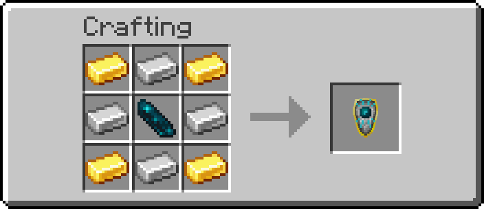

## 🩸 Crimson Sword

A legendary weapon that grows stronger through combat, feeding on the blood of its enemies.

| Stat | Value |
|------|-------|
| Attack Damage (HP) | 7 |

| Feature | Details |
|---------|---------|
| Acquisition | Boss Drop / Quest Reward |
| Experience Source | Damage Dealt |
| Passive Scaling | +1% Damage per weapon level (up to +30% at level 30) |

**Progression**:

| Level | Effect |
|-------|--------|
| **5** | Lifesteal: 3% of damage dealt. |
| **10** | Crimson Aura (10s): Drains 1 HP/s from entities within 2.5 blocks. |
| **15** | Lifesteal: 6% of damage dealt. |
| **20** | Crimson Aura (20s): Drains 2 HP/s from entities within 2.5 blocks. |
| **25** | Lifesteal: 10% of damage dealt. |
| **30** | Crimson Aura (30s): Drains 3 HP/s from entities within 2.5 blocks. |

## ⚓ Anchor

A heavy, slow-swinging marine weapon with crowd-control capability and a grappling-hook active utility.

| Stat | Value |
|------|-------|
| Attack Damage (HP) | 8 |

| Feature | Details |
|---------|---------|
| Snare | Melee attacks temporarily lock the target in place and prevent jumping, wrapping their feet in a visual coral display. Default duration: 2 seconds; default cooldown: 5 seconds. Duration, cooldown and availability are configurable. |
| Hook | Right-click launches the anchor as a projectile. Default range: 20 blocks and cooldown: 5 seconds; range, cooldown and availability are configurable. Each player can have only one anchor in flight at a time. Hitting a block pulls you to it. Hitting a living entity deals 1 damage and can pull you and the target together. Shield blocks still allow pulling. The anchor returns after the flight; if the inventory cannot hold it, it drops at the impact or logout location. |

**Crafting** (Shaped Recipe):

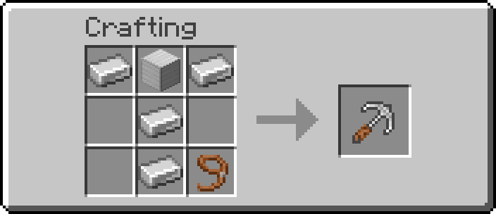

## 🗡️ Throwing Knife

A consumable ranged weapon that's perfect for finishing off fleeing enemies or opening a fight from a distance.

| Stat | Value |
|------|-------|
| Attack Damage (HP) | 5 |

| Feature | Details |
|---------|---------|
| Throwing | Right-click to throw one knife from the stack. The cooldown is 0.4 seconds. |

**Crafting** (Shaped Recipe):

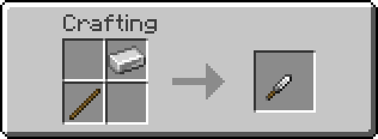

The recipe produces 4 knives.

## ⚡ Stormcleaver

A legendary diamond axe with an aggressive charge-and-leap combat loop.

| Stat | Value |
|------|-------|
| Attack Damage (HP) | 9 |

| Feature | Details |
|---------|---------|
| Static Charge | Each successful attack adds a charge. Default: 5 charges required and a 2-second decay interval; both the required charges and decay interval are configurable. Partial charge slowly decays; full charge stays ready until used. |
| Thunder Leap | Right-click while grounded at full charge to launch upward. Default jump velocity multiplier: 1.5; it is configurable. Landing creates an 8-block, 6-damage knockback shockwave and lightning strikes. A blocked ceiling triggers the impact immediately. |
| Protection | Shockwave damage respects region and PvP protection and never ignites blocks. |

**Crafting** (Shaped Recipe):

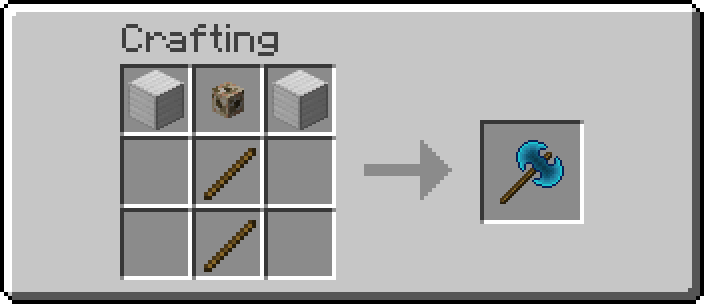

## 🔥 Emberfang

A blade of hardened magma that burns both its targets and careless wielders.

| Stat | Value |
|------|-------|
| Attack Damage (HP) | 5 |

| Feature | Details |
|---------|---------|
| Ember Strike | Strikes deal the default additional 4 fire damage; the fire damage is configurable and target defenses can reduce the bonus. |
| Ignition | Strikes have a 5% chance to set the target ablaze for 2 seconds. |
| Self-Burn | Burns its wielder unless they wear at least one armor piece enchanted with **Fire Protection**. |

**Crafting** (Shaped Recipe):

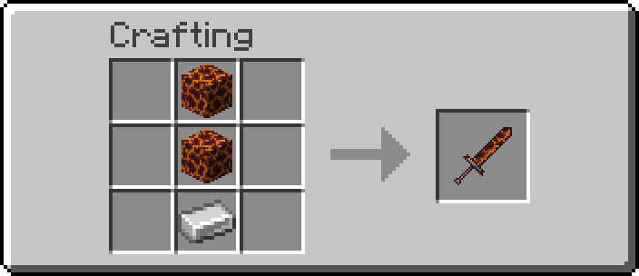

## Obsidian Glaive

A one-handed obsidian polearm combining sweeping strikes with a piercing thrust.

| Stat | Value |
|------|-------|
| Attack Damage (HP) | 7 by default; configurable |

| Feature | Details |
|---------|---------|
| Combo | Cut → Cut → Thrust. Resets after 8 seconds without a successful hit or when unequipped. |
| Cut | Sweeps nearby targets within a 4-block range. Targets closer than the 1.5-block close range take 30% damage with extra knockback. |
| Thrust | Pierces enemies in a line up to 4.5 blocks (6.5 in Creative), with no minimum range. Thrust and lift can be disabled independently in the configuration. |

**Crafting** (Shaped Recipe):

|   |   |   |
|---|---|---|
| Empty | Empty | Obsidian |
| Empty | Stick | Empty |
| Stick | Empty | Empty |

## Give Names

The `/pepeforge give` command and its available item IDs are documented in the [Commands section of `README.md`](README.md#commands).
